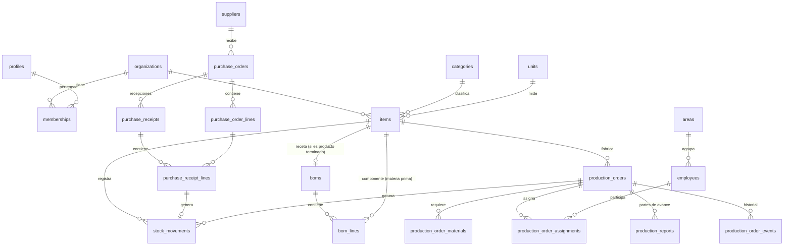

# FABRIL — Plan técnico (Etapa 1)

> Estado: **propuesta para aprobación** · Fecha: 09/11/2026
> Este documento es la referencia de arquitectura y decisiones del proyecto. Las decisiones marcadas como **[Decisión propia]** son criterios del equipo técnico que pueden revisarse; las marcadas **[A confirmar]** requieren respuesta del dueño del producto.

---

## 0. Estado actual del repositorio

- Directorio vacío, sin repositorio git ni código previo. No hay stack heredado que respetar.
- Entorno: Windows 11, Node 24.13, npm 11.6, git 2.52, Supabase CLI disponible vía `npx`.
- **Docker no está instalado** → no se puede levantar Supabase local (`supabase start`). Ver §11 (pregunta 1).
- Versiones estables a la fecha: Next.js 16.4, Tailwind CSS 4.3, Zod 4.x, `@supabase/ssr` 0.12. Se fijan versiones exactas al crear el proyecto.

---

## 1. Visión del producto y principios

FABRIL es un SaaS multi-fábrica: cada fábrica es una **organización** aislada. El caso de demo es una fábrica de plásticos, pero nada del modelo es específico de plásticos (los rubros se expresan con categorías, unidades y recetas).

Principios que guían las decisiones:

1. **El inventario es un libro contable.** El stock nunca se edita: se deriva de movimientos inmutables. Cualquier corrección es un movimiento nuevo que referencia al anterior.
2. **La lógica crítica vive en la base de datos.** Cambios de estado de órdenes, recepción de compras, consumos y ajustes se ejecutan como funciones PostgreSQL transaccionales. El frontend nunca calcula stock ni escribe movimientos directamente.
3. **Seguridad por defecto.** RLS en todas las tablas; el cliente usa sólo la clave pública; la clave secreta existe únicamente en el servidor y sólo para tareas administrativas puntuales.
4. **Nada decorativo.** Todo botón hace algo real. Lo que no entra en v1 no se muestra.
5. **Pensado para el operario y para el dueño.** Pantallas densas en datos pero legibles; flujos de pocos pasos para lo frecuente (registrar avance, recibir mercadería, ajustar stock).

### Objetivos (v1)
Productos, materias primas, inventario con trazabilidad, recetas (BOM), órdenes de producción con ciclo completo, proveedores y compras con recepción parcial, empleados y asignación, costos planificado vs real, reportes con filtros, dashboard, roles, landing pública, datos demo.

### No-objetivos (v1)
Ventas/facturación electrónica (AFIP/ARCA), liquidación de sueldos, múltiples depósitos, lotes y vencimientos, conversiones entre unidades, máquinas/centros de trabajo, planificación de capacidad, app móvil nativa, facturación del SaaS (suscripciones). Quedan anotados como roadmap (§12).

### Anti-objetivos (sería un fracaso aunque “funcione”)
- Stock que no coincide con la suma de sus movimientos.
- Poder modificar historia sin dejar rastro.
- Que un usuario de una fábrica vea datos de otra.
- Pantallas con datos inventados o botones sin acción.
- Una interfaz genérica tipo “plantilla de admin”.

---

## 2. Stack y arquitectura

| Capa | Elección |
|---|---|
| Framework | Next.js 16 (App Router, Server Components, Server Actions), TypeScript `strict` |
| UI | Tailwind CSS 4, shadcn/ui (Radix), Lucide, Recharts |
| Formularios | React Hook Form + Zod (los mismos esquemas validan en cliente y en Server Actions) |
| Tablas | TanStack Table con paginación/orden/filtros **del lado del servidor**, estado en la URL |
| Datos | Supabase: PostgreSQL + Auth + Storage, RLS, funciones RPC |
| Fechas/números | `Intl` con locale `es-AR`, zona `America/Argentina/Buenos_Aires`, `date-fns` para cálculos |
| Notificaciones UI | `sonner` (toasts de shadcn) |
| Tests | Vitest (lógica pura y esquemas), pruebas SQL de funciones críticas, Playwright (flujos E2E) |
| Deploy | Vercel + Supabase Cloud |

### 2.1 Flujo de datos

```
Navegador ──► Server Component ──► supabase (JWT del usuario, RLS aplica) ──► Postgres
   │
   └─ formulario ──► Server Action
                       1. valida con Zod
                       2. verifica sesión + rol (requireRole)
                       3. CRUD simple → tabla (RLS vuelve a verificar)
                          operación de negocio → RPC transaccional (verifica rol de nuevo)
                       4. revalidatePath / revalidateTag → la UI y el dashboard se actualizan
                       5. devuelve { ok, data } | { ok:false, error, fieldErrors }
```

- **Lecturas**: en Server Components, con el cliente Supabase de servidor (cookies del usuario). Sin API routes intermedias salvo exportaciones CSV.
- **Escrituras**: Server Actions con un wrapper común (`action()` en `lib/actions`) que estandariza validación, control de rol, mapeo de errores de Postgres a mensajes en español y respuesta tipada.
- **Defensa en profundidad**: el rol se verifica en la UI (ocultar/deshabilitar), en la Server Action y en la base (RLS o chequeo dentro de la RPC). La base es la autoridad final.
- **Clave secreta**: sólo en `lib/supabase/admin.ts` con `import "server-only"`, usada para invitar usuarios y crear/restablecer la organización demo.
- Tipos generados con `supabase gen types typescript` → `src/types/database.ts`.

### 2.2 Estructura de carpetas

```
src/
  app/
    (marketing)/            → landing pública  (/ , /precios? no en v1)
      page.tsx
    (auth)/                 → /ingresar, /recuperar, /restablecer
    auth/callback/route.ts  → intercambio de código (confirmación de email, invitaciones)
    app/                    → sistema (requiere sesión)
      layout.tsx            → shell: sidebar + topbar
      page.tsx              → dashboard
      productos/ materias-primas/ inventario/ produccion/ compras/
      proveedores/ empleados/ costos/ reportes/ configuracion/
  features/<módulo>/
    schemas.ts              → Zod (compartido cliente/servidor)
    queries.ts              → lecturas (server-only)
    actions.ts              → Server Actions ("use server")
    logic.ts                → cálculos puros testeables (ej. requerimientos BOM)
    components/             → componentes específicos del módulo
  components/
    ui/                     → shadcn
    layout/                 → Sidebar, Topbar, CommandMenu, OrgSwitcher, UserMenu
    data-table/             → DataTable, toolbar, filtros, paginación
    forms/                  → FormField, NumberInput (acepta “0,250”), DateInput, MoneyInput, ImageUpload
    feedback/               → EmptyState, ConfirmDialog, ErrorState, Skeletons
    data/                   → StatCard, StatusBadge, ProgressBar, Timeline, KPI deltas
    charts/                 → wrappers de Recharts con tema
  lib/
    supabase/ (server.ts, client.ts, admin.ts, proxy.ts)
    auth/ (getSession, getActiveOrg, requireRole, permisos.ts)
    format.ts               → moneda ARS, números, fechas DD/MM/AAAA
    actions.ts              → wrapper de Server Actions + mapeo de errores
  types/database.ts
  proxy.ts                  → refresco de sesión y protección de /app (Next 16)
supabase/
  migrations/               → SQL versionado (esquema, RLS, funciones, triggers)
  seed/                     → función de datos demo
  tests/                    → pruebas SQL de funciones críticas
docs/                       → este plan y decisiones (ADR breves)
```

Convención: **código, tablas y columnas en inglés; rutas, UI y mensajes en español.**

---

## 3. Multi-tenancy, autenticación y roles

### 3.1 Organizaciones **[Decisión propia]**
Cada fábrica es una `organization`. Toda tabla de negocio tiene `organization_id` (indexado) y RLS que exige membresía. Un usuario puede pertenecer a varias organizaciones (ej.: su fábrica real + la demo) y cambia entre ellas desde el selector del sidebar. La organización activa se guarda en una cookie y se valida contra la membresía en cada request.

### 3.2 Autenticación
- Supabase Auth con email + contraseña, confirmación de email, recuperación de contraseña.
- `@supabase/ssr` con cookies; `proxy.ts` refresca la sesión y redirige `/app/*` → `/ingresar` si no hay sesión.
- **Sin registro abierto** (decidido). No existe `/registro` ni onboarding público. Las cuentas se crean de dos formas:
  - **Alta de una fábrica nueva** (tarea del proveedor del SaaS): script `npm run fabrica:crear -- --nombre "..." --email "..."` que usa la clave secreta desde la terminal, crea la organización y envía la invitación al administrador. No hay pantalla pública para esto.
  - **Usuarios adicionales de la misma fábrica**: el administrador invita por email desde Configuración → Usuarios (`inviteUserByEmail` en el servidor). El invitado define su contraseña en `/restablecer` y queda unido a la organización.
- La landing pública vive en `/` y el panel de administración en `/app` (rutas separadas; `/app/*` exige sesión).

### 3.3 Roles (decidido: un único rol en v1)

El panel lo usa **el dueño o administrador de la fábrica**, por lo que v1 tiene un solo rol, **Administrador**, con acceso completo a todos los módulos, usuarios y configuración. Empleados y operarios se registran como datos (para asignarlos a órdenes y costear horas), no como usuarios del sistema.

Para no cerrar la puerta a futuro **[Decisión propia]**: la columna `memberships.role` y las funciones `has_role()` existen desde el inicio, y toda política RLS, RPC y Server Action verifica permisos a través de ellas. Agregar roles más adelante (supervisor, operario, consulta) es extender el enum y la matriz, sin reescribir módulos. La matriz de abajo queda como **referencia para el roadmap**, no se implementa en v1.

| Permiso (roadmap) | Administrador | Supervisor | Operario | Consulta |

| Permiso | Administrador | Supervisor | Operario | Consulta |
|---|:-:|:-:|:-:|:-:|
| Ver dashboard, productos, inventario, producción, compras, empleados (roadmap) | ✔ | ✔ | ✔ | ✔ |
| Crear/editar productos, materias primas, recetas | ✔ | ✔ | — | — |
| Ajustes y movimientos manuales de stock | ✔ | ✔ | — | — |
| Crear/editar/cancelar órdenes de producción | ✔ | ✔ | — | — |
| Registrar avance y pasar a control de calidad (órdenes asignadas) | ✔ | ✔ | ✔ | — |
| Completar órdenes (cierre con consumos reales) | ✔ | ✔ | — | — |
| Proveedores y órdenes de compra | ✔ | ✔ | — | — |
| Recibir mercadería (recepción de compras) | ✔ | ✔ | ✔ | — |
| Empleados (alta/edición) | ✔ | ✔ | — | — |
| Costos y reportes | ✔ | ✔ | — | ✔ |
| Usuarios, roles y configuración de la fábrica | ✔ | — | — | — |

- Implementación v1: enum `app_role` con el valor `admin`; funciones `private.is_member(org)` y `private.has_role(org, roles[])` (`security definer`, `stable`, usando `(select auth.uid())` para que Postgres las evalúe una vez por consulta). `lib/auth/permisos.ts` centraliza los chequeos del lado de la app.
- El control de acceso sigue siendo real en backend: sin sesión no hay acceso a `/app`, y sin membresía activa en la organización la base no devuelve ni acepta nada (RLS), aunque alguien llame a la API directamente.
- Siempre debe existir al menos un administrador activo por organización (trigger lo garantiza): nadie puede quitarse a sí mismo el acceso si es el último.

---

## 4. Modelo de datos

Tipos: cantidades `numeric(14,3)`, importes `numeric(14,2)`, costos unitarios `numeric(14,4)`, fechas de calendario `date`, instantes `timestamptz`. Todas las tablas tienen `id uuid`, `organization_id`, `created_at`, `updated_at`, `created_by` salvo indicación.

### 4.1 Diagrama de relaciones



### 4.2 Tablas

**Núcleo**
- `organizations`: name, legal_name, cuit, address, city, province, phone, email, logo_path, `is_demo` bool, default_waste_pct, default_labor_rate (ARS/h), allow_negative_stock (default false), timezone.
- `profiles` (1:1 con `auth.users`): full_name, avatar_path, last_organization_id.
- `memberships`: organization_id, user_id, role (`admin|supervisor|operator|viewer`), status (`active|invited|disabled`). Único (organization_id, user_id).
- `document_sequences`: organization_id, doc_type (`OP|OC|AJ`), year, last_value → genera códigos `OP-2026-0042`, `OC-2026-0017` sin colisiones.
- `activity_log`: actor_id, entity_type, entity_id, action, summary (texto en español listo para mostrar), metadata jsonb. Alimenta “Actividad reciente” y el historial de cada ficha. Insert sólo desde funciones/triggers.

**Catálogo**
- `units` (global, de sistema, sólo lectura): code (`kg`, `g`, `u`, `l`, `ml`, `m`, `m2`), name, allows_decimals. Sin conversiones en v1: cada ítem se almacena en una unidad y la receta se expresa en la unidad del componente.
- `categories`: name, applies_to (`finished_good|raw_material|both`), color.
- `items` — **una sola tabla para productos terminados y materias primas** **[Decisión propia]**: type (`finished_good|raw_material`), sku (único por organización), name, description, category_id, unit_id, image_path, status (`active|inactive`), min_stock, sale_price (opcional), manual_cost (costo estimado cuando no hay receta), standard_labor_minutes y overhead_per_unit (terminados), preferred_supplier_id y last_purchase_cost (materias primas), `archived_at`.
  - Columnas **mantenidas sólo por triggers**: `current_stock`, `avg_cost` (costo promedio ponderado). El rol `authenticated` no tiene permiso de UPDATE sobre ellas (grants por columna).
  - Motivo de una tabla única: inventario, movimientos, recetas y reportes tratan ambos tipos igual; la UI los separa en módulos distintos (`/app/productos` y `/app/materias-primas`).
  - Eliminar: si el ítem no tiene movimientos, recetas ni órdenes → borrado real; si tiene historia → se **archiva** (deja de aparecer, la historia queda intacta). La UI lo explica en el diálogo de confirmación.

**Recetas (BOM)**
- `boms`: item_id (único: una receta activa por producto en v1), output_qty (default 1), default_waste_pct, notes.
- `bom_lines`: bom_id, component_item_id (debe ser materia prima de la misma organización, nunca el propio producto), quantity (por `output_qty`), waste_pct (opcional, si es nulo usa el de la receta), position.
- Las recetas se editan en el lugar; las órdenes de producción **copian** los requerimientos al crearse, así que cambiar una receta nunca altera órdenes existentes. Versionado formal de recetas: roadmap.

**Inventario**
- `stock_movements` — **append-only**:
  - item_id, movement_type, quantity (con signo: + entra, − sale), unit_cost (foto del costo en ese momento), total_cost, balance_after (stock resultante, para el kardex), reason (texto obligatorio en ajustes/manuales), occurred_at, created_by.
  - Referencias: production_order_id, purchase_receipt_line_id, reverses_movement_id (anulación).
  - Tipos: `purchase_receipt` (entrada por compra), `production_output` (entrada por producción), `production_consumption` (consumo), `production_return` (devolución de material sobrante), `production_scrap` (merma/desperdicio adicional), `adjustment` (ajuste por inventario físico, ±), `manual_in`, `manual_out` (ej.: despacho/venta, devolución a proveedor), `reversal` (anulación de un movimiento manual).
  - Sin políticas UPDATE/DELETE y trigger que rechaza cualquier modificación. Sin INSERT directo desde el cliente: sólo vía funciones.
  - Trigger `after insert`: bloquea la fila del ítem (`for update`), recalcula `current_stock`, valida que no quede negativo (salvo configuración) y actualiza `avg_cost` según las reglas de valorización de abajo.
  - **Fecha de los movimientos** **[Decisión propia]**: `occurred_at` es siempre el momento en que se registra (`now()`), así el kardex y el costo promedio se calculan en orden y nunca hay que recalcular historia. La fecha del documento (fecha del remito, fecha del parte de avance) se guarda aparte en el documento y es la que usan los reportes por período. Única excepción: el generador de datos demo, que inserta la historia en orden cronológico estricto mediante un camino interno no expuesto a la API.
  - **Reglas de valorización** **[Decisión propia]**:
    | Movimiento | Costo unitario | ¿Recalcula promedio? |
    |---|---|---|
    | `purchase_receipt` | precio neto de la línea | Sí |
    | `production_output` | costo real unitario de la orden | Sí |
    | `manual_in` | costo informado por el usuario; si no informa, costo promedio vigente | Sólo si se informa costo |
    | `adjustment` positivo | costo promedio vigente | No |
    | Salidas (`production_consumption`, `production_scrap`, `manual_out`, `adjustment` negativo) | costo promedio vigente | No |
    | `production_return` | costo al que se consumió ese material en esa orden | Sí |
    | `reversal` | costo del movimiento original | Sí (deshace el efecto: valor total − cant. × costo original) |
    Si el stock queda en cero, el promedio conserva su último valor.
  - **Negativos**: la configuración `allow_negative_stock` (por defecto desactivada) aplica por igual a **todas** las salidas, incluidos inicio y cierre de producción. Si al completar una orden el consumo real supera el stock, la operación falla con un mensaje que indica cuánto falta y sugiere registrar primero la entrada o el ajuste correspondiente.
- Vista `item_stock_status`: stock físico, **comprometido** (materiales requeridos por órdenes planificadas aún no iniciadas), disponible = físico − comprometido, y nivel (`ok|low|out`) según `min_stock`.

**Compras**
- `suppliers`: name, legal_name, cuit, contact_name, email, phone, address, city, payment_terms, notes, status.
- `purchase_orders`: code, supplier_id, status (`draft|pending|partially_received|received|closed|cancelled`; `closed` = “Cerrada con faltantes”, para una orden parcialmente recibida cuyo saldo ya no se espera **[Decisión propia]**: se agrega a los estados pedidos porque ni “Recibida” ni “Cancelada” describen ese caso con honestidad), order_date, expected_date, notes, subtotal, tax_total, total (recalculados por trigger desde las líneas).
- `purchase_order_lines`: item_id (materia prima), quantity, unit_price (neto), tax_rate (21 / 10,5 / 27 / 0), received_qty (mantenido por trigger).
- `purchase_receipts`: purchase_order_id, received_at, delivery_note_number (n.º de remito), notes.
- `purchase_receipt_lines`: receipt_id, purchase_order_line_id, quantity → cada línea genera un movimiento `purchase_receipt` al costo neto de la línea.
- El costo de inventario usa el **precio neto sin IVA** (el IVA es crédito fiscal). **[Decisión propia]**

**Empleados**
- `areas`: name (Inyección, Soplado, Extrusión, Depósito, Calidad, Mantenimiento, Administración en la demo).
- `employees`: first_name, last_name, position, area_id, email, phone, hire_date, status (`active|on_leave|inactive`), photo_path, hourly_cost (opcional, para costeo de mano de obra), user_id (opcional: vínculo con un usuario del sistema), notes.
  - Empleado ≠ usuario: muchos operarios no necesitan cuenta, pero sí figurar en las órdenes.

**Producción**
- `production_orders`: code, item_id, status (`planned|in_progress|quality_check|completed|cancelled`), priority (`low|normal|high|urgent`), planned_qty, good_qty, defective_qty, planned_start_date, planned_end_date, started_at, completed_at, cancelled_at, cancel_reason, notes, responsible_employee_id, costos planificados (material/mano de obra/indirectos, foto al crear) y costos reales (calculados al completar).
- `production_order_materials`: item_id, qty_per_unit, waste_pct, planned_qty (= planned_qty × qty_per_unit × (1 + waste%)), consumed_qty, cost_consumed.
- `production_order_assignments`: employee_id, role_in_order (`responsable|operario|calidad`), hours_worked.
- `production_reports` (partes de avance): report_date, good_qty, defective_qty, employee_id, notes. Su suma actualiza `good_qty`/`defective_qty` de la orden → barra de progreso.
- `production_order_events`: from_status, to_status, note, actor, fecha → historial de cambios de estado (también registra partes de avance y edición de fechas).
- **“Demorada” no es un estado, es una condición calculada**: `planned_end_date < hoy` y estado ∈ {planificada, en producción, control de calidad}. Se muestra como badge y filtro. **[Decisión propia]** (evita estados inconsistentes y no requiere tareas programadas).

### 4.3 Storage
- Buckets privados `item-images` y `employee-photos`, rutas `{organization_id}/{uuid}.webp`, políticas que exigen membresía en la organización del prefijo. Se muestran con URLs firmadas. Límite 2 MB, se redimensiona en el cliente antes de subir.

### 4.4 Funciones de negocio (RPC transaccionales)

Todas: `security definer`, `set search_path = ''`, verifican `has_role`, bloquean filas afectadas, escriben `activity_log` y eventos, y devuelven el registro actualizado. Ejecución revocada para `anon`.

| Función | Qué hace |
|---|---|
| `create_production_order(item, qty, fechas, prioridad, responsables, notas)` | Genera código, copia la receta a `production_order_materials` con desperdicio, calcula costo planificado, informa faltantes (no bloquea crear: se puede planificar antes de comprar). |
| `start_production_order(id)` | Planificada → En producción. Verifica stock suficiente de **todos** los materiales; si falta alguno, falla con detalle de faltantes. Registra consumos (`production_consumption`) por la cantidad planificada al costo promedio vigente. |
| `report_production_progress(id, buenas, defectuosas, empleado, nota)` | Registra parte de avance (operario puede, si está asignado). |
| `send_to_quality_check(id)` / `return_to_production(id, nota)` | Transiciones con historial (retrabajo permitido). |
| `complete_production_order(id, buenas_finales, defectuosas_finales, consumos_reales[], horas[], nota)` | Control de calidad → Completada. Control de calidad **confirma las cantidades finales** (prellenadas con la suma de los partes de avance) y puede reclasificar buenas como defectuosas; la diferencia queda en el historial. Concilia consumo real vs planificado por material: sobrante → `production_return` (al costo de consumo); exceso → `production_scrap`. Ingresa las buenas como `production_output` al costo real unitario. Las defectuosas **no pasan por el libro de stock** (nunca entraron): quedan registradas en la orden y en los reportes de rendimiento. Si no hay unidades buenas, no hay ingreso y el costo total se reporta como pérdida. Completar con menos unidades que las planificadas es el camino para un “cierre anticipado”. |
| `cancel_production_order(id, motivo, devoluciones[])` | Desde planificada: sin efecto en stock. Desde en producción/calidad: el material devuelto vuelve al stock al costo de consumo; **el no devuelto se registra como `production_scrap`** (aparece en desperdicio y costos). Las unidades que se hubieran fabricado se descartan; si sirven, lo correcto es completar la orden con esa cantidad, y la UI lo sugiere. |
| `reverse_purchase_receipt(id, líneas[], motivo)` | Anula total o parcialmente una recepción (cantidad mal cargada o devolución al proveedor): movimientos `reversal` al costo original, descuenta `received_qty`, recalcula estado de la orden y costo promedio. |
| `confirm_purchase_order(id)` | Borrador → Pendiente (valida que tenga líneas). |
| `receive_purchase_order(id, remito, fecha, líneas[])` | Crea recepción, movimientos de entrada, actualiza `received_qty`, `last_purchase_cost`, costo promedio y el estado (parcial/recibida). No permite recibir más de lo pedido (+ tolerancia configurable en roadmap). |
| `cancel_purchase_order(id, motivo)` | Borrador/pendiente → cancelada; parcialmente recibida → “cerrar saldo” (queda recibida parcial cerrada). |
| `create_stock_adjustment(item, cantidad_contada \| delta, motivo)` | Ajuste por conteo físico: calcula la diferencia y registra un movimiento. |
| `create_manual_movement(item, tipo, cantidad, motivo)` | Entradas/salidas manuales (ej. despacho). |
| `reverse_stock_movement(id, motivo)` | Anula un movimiento manual/ajuste con un movimiento inverso. Los movimientos de compras se corrigen con `reverse_purchase_receipt`. **Una orden de producción completada no se reabre en v1** **[Decisión propia]**: un error de consumo se corrige con un ajuste cuyo motivo referencia la orden. |
| `create_purchase_from_shortages(production_order_id, supplier)` | Crea un borrador de orden de compra con los faltantes de una orden de producción. |
| `create_demo_organization()` / `reset_demo_organization(id)` | Ver §8. |

### 4.5 Vistas de lectura (reportes y dashboard)
`item_stock_status`, `item_standard_cost` (costo estándar por unidad desglosado), `production_order_overview` (con flag demorada y % de avance), `production_order_costs` (planificado vs real y desvío), y funciones con rango de fechas para reportes: `report_production(from, to, granularity)`, `report_material_consumption`, `report_waste`, `report_purchases`, `report_stock_movements`, `report_yield`. Todas respetan RLS (`security invoker`).

---

## 5. Flujos principales

### 5.1 Procedimiento de inventario en producción **[Decisión propia, a validar]**

```
Planificada ──iniciar──► En producción ──► Control de calidad ──completar──► Completada
   │  materiales            │  consumo de          │  ▲ retrabajo            ingreso de
   │  "comprometidos"       │  materias primas     └──┘                      producto terminado
   │  (no salen del stock)  │  (cant. planificada                            + conciliación de
   │                        │   incl. desperdicio)                           consumo real
   └──────── cancelar (desde cualquier estado no final; devuelve material no usado) ──► Cancelada
```

- **Al planificar**: el material queda *comprometido* (afecta el “disponible”, no el stock físico). Si no alcanza, la ficha muestra faltantes y ofrece “Crear orden de compra con faltantes”.
- **Al iniciar**: sale del stock la cantidad planificada (con su % de desperdicio previsto). Si no hay stock suficiente, no se puede iniciar.
- **Al completar**: se informa el consumo real; las diferencias generan devolución o merma, por lo que el **desperdicio real queda medido por material y por orden**. Ingresan las unidades buenas al costo real.
- Alternativa descartada: descontar todo recién al completar (*backflush*). Es más simple, pero durante días el stock de materia prima aparece mayor de lo real y no se detectan faltantes a tiempo.

### 5.2 Compra
Borrador → (confirmar) Pendiente → (recibir, una o varias veces, con n.º de remito) Parcialmente recibida → Recibida. Cada recepción actualiza stock y costo promedio en la misma transacción.

### 5.3 Cálculo de materiales (BOM)
`requerido = cantidad_a_fabricar × (cantidad_por_unidad / rendimiento_receta) × (1 + desperdicio%)`
Ej.: 1.000 bidones × 0,250 kg × 1,03 = 257,500 kg de polietileno. La función pura vive en `features/production/logic.ts` (testeada) para la vista previa en el formulario, y la misma regla está en SQL para el cálculo definitivo. Prueba automática que compara ambas.

### 5.4 Costeo
- **Materias primas**: costo promedio ponderado, actualizado en cada recepción. Se muestra también el último precio de compra (útil con inflación).
- **Costo estándar del producto (por unidad)** = Σ(cantidad del material / rendimiento de la receta × costo promedio × (1+desp.)) + (minutos estándar / 60 × costo hora por defecto) + indirectos por unidad.
- **Costo planificado de una orden**: foto del estándar al crearla × cantidad planificada.
- **Costo real**: valor de los consumos netos (consumo al iniciar + excesos − devoluciones, cada uno con el costo definido en las reglas de valorización de §4.2) + horas registradas × costo hora del empleado (o el por defecto) + indirectos × unidades buenas. Costo real unitario = total / unidades buenas (si son cero, no hay costo unitario y el total se informa como pérdida).
- Pantalla de Costos: tabla de productos con costo estándar desglosado y margen (si hay precio de venta); tabla de órdenes completadas con planificado vs real, desvío $ y %.

---

## 6. Páginas y rutas

| Ruta | Contenido |
|---|---|
| `/` | Landing pública |
| `/ingresar`, `/recuperar`, `/restablecer` | Autenticación (sin registro público; `/restablecer` también sirve para aceptar invitaciones) |
| `/app` | Dashboard |
| `/app/productos`, `/app/productos/[id]` | Productos terminados. Ficha con pestañas: Resumen · Receta · Movimientos · Órdenes · Costos |
| `/app/materias-primas`, `/app/materias-primas/[id]` | Materias primas. Ficha: Resumen · Movimientos · Compras · Usado en (recetas) |
| `/app/inventario` | Existencias de todo (filtros por tipo, categoría, nivel de stock), acciones: entrada, salida, ajuste |
| `/app/inventario/movimientos` | Historial/kardex con filtros por fecha, tipo, ítem, usuario, referencia |
| `/app/produccion` | Órdenes (vista tabla + vista tablero por estado), filtros, demoradas |
| `/app/produccion/nueva` | Alta con vista previa de materiales y disponibilidad en vivo |
| `/app/produccion/[id]` | Ficha: progreso, materiales (requerido/disponible/consumido), personal, partes de avance, costos, historial |
| `/app/compras`, `/app/compras/nueva`, `/app/compras/[id]` | Órdenes de compra, recepciones |
| `/app/proveedores`, `/app/proveedores/[id]` | Proveedores con historial de compras |
| `/app/empleados`, `/app/empleados/[id]` | Personal y órdenes en las que participa |
| `/app/costos` | Costos estándar y planificado vs real |
| `/app/reportes` | Reportes con rango de fechas y exportación CSV |
| `/app/configuracion` | General (datos de la fábrica, desperdicio por defecto, costo hora), Usuarios y roles, Categorías, Áreas, Datos demo |

Elementos globales del shell: sidebar colapsable (en móvil, drawer), selector de organización con badge **DEMO**, buscador global `Ctrl+K` (productos, materias primas, órdenes, proveedores, empleados), campana de alertas (calculadas en vivo: stock bajo/agotado, órdenes demoradas, compras con entrega vencida), menú de usuario, modo claro/oscuro.

---

## 7. Diseño y experiencia

**Dirección visual: “industrial preciso”** **[Decisión propia, se valida con mockups en Etapa 2]**
- Base neutra grafito/zinc, superficies planas con bordes finos (estilo Linear/Vercel), sin gradientes ni sombras pesadas.
- **Un único color de acento** (propuesta: ámbar señalización industrial, usado con mesura en acciones primarias y foco) y una paleta semántica para estados.
- Tipografía: Geist Sans para interfaz; **Geist Mono con cifras tabulares** para SKUs, códigos de orden, cantidades y montos (lectura rápida en columnas).
- Densidad media-alta en tablas, con filas de 40 px, encabezados fijos y acciones por fila en menú.
- Estados con badge consistente: Planificada (gris azulado) · En producción (azul) · Control de calidad (violeta) · Completada (verde) · Cancelada (gris tachado) · Demorada (rojo, como marca adicional). Compras: Borrador · Pendiente · Parcial · Recibida · Cancelada.
- Modo claro y oscuro desde el inicio (tokens CSS).
- Responsive: en móvil las tablas pasan a lista de tarjetas con los 3-4 datos clave; las acciones frecuentes del operario (registrar avance, recibir mercadería) están pensadas para usarse en planta desde el teléfono.

**Formato Argentina** (`lib/format.ts`): `$ 1.234.567,89`, `1.234,5 kg`, `09/11/2026`, `09/11/2026 14:35`. Los campos numéricos aceptan coma decimal; los de fecha muestran DD/MM/AAAA.

**Patrones de interacción**: modales para altas rápidas (proveedor, ajuste, entrada/salida); páginas completas para documentos con líneas (orden de compra, orden de producción); confirmación con texto explicativo antes de cancelar/archivar/eliminar; skeletons de carga; estados vacíos con explicación y la acción para empezar; toasts de éxito/error con mensajes en español (errores de Postgres traducidos: “No hay stock suficiente de Polietileno AD: faltan 12,500 kg”).

**Dashboard**: fila de KPIs (productos, materias primas, valor de inventario, órdenes activas, unidades fabricadas en el mes con variación vs mes anterior), panel de alertas (stock bajo, órdenes demoradas/pendientes), gráfico de producción mensual (barras, 12 meses), gráfico de movimientos de inventario (entradas vs salidas valorizadas), actividad reciente, accesos rápidos (nueva orden de producción, nueva compra, nuevo producto). Todo desde la base; se revalida tras cada operación.

**Landing**: hero con propuesta de valor y captura real del dashboard, problemas que resuelve (planillas, stock que no cierra, costos desconocidos), beneficios, funcionalidades por módulo con capturas reales, “cómo funciona” en 3 pasos, preguntas frecuentes, CTA “Solicitar demostración” con un formulario real (nombre, empresa, email, teléfono, rubro, mensaje) que guarda la solicitud en la tabla `demo_requests` (el visitante anónimo sólo puede insertar, nunca leer; validación Zod, campo trampa anti-spam y límite por IP), y botón “Ingresar” hacia `/ingresar` para clientes existentes; footer. Las capturas se generan en la Etapa 5 a partir de la app real con datos demo (Playwright), reemplazando los marcadores de la Etapa 2.

---

## 8. Datos de demostración

- Se crean en una **organización separada** marcada `is_demo = true` (“Plásticos del Litoral S.A.”, ficticia). Nunca se mezclan con datos reales: la separación es la misma que entre dos clientes distintos. La interfaz muestra un badge DEMO permanente.
- Función `create_demo_organization()` (determinística, con semilla fija) que genera ~6 meses de historia coherente:
  - 12 productos terminados (bidones 5 L y 20 L, baldes 10 L y 20 L, botellas 500 ml y 1 L, tapas 28 mm y 38 mm, envases 250 g y 1 kg, cajas organizadoras chica y grande) con receta.
  - 14 materias primas (PEAD, PEBD, PP homopolímero, PP copolímero, PET, masterbatch de colores, etiquetas, asas metálicas, precintos, cajas de embalaje, film stretch…).
  - 5 proveedores, 7 áreas, 16 empleados con costo hora.
  - ~35 órdenes de compra en todos los estados, con recepciones parciales.
  - ~60 órdenes de producción en todos los estados, algunas demoradas, con partes de avance, defectuosas y desperdicio variable.
  - Movimientos generados **siguiendo las mismas reglas** que la operación normal (consumos al iniciar, ingresos al completar), con fechas históricas. Al final, una verificación asegura que `current_stock` = Σ movimientos para cada ítem.
  - Algunos ítems quedan intencionalmente bajo el mínimo para que las alertas tengan contenido.
- **Sin demo pública** (decidido). La demo se crea con `npm run demo:crear -- --email "..."`, que genera la organización demo y le da acceso al usuario indicado. Ese usuario la ve en el selector de organización junto a su fábrica real, con el badge DEMO, y puede usarla para mostrar el producto o probar flujos sin tocar datos reales. Las organizaciones demo no permiten invitar usuarios.
- `reset_demo_organization()` borra en cascada y regenera. Disponible desde Configuración → Datos demo (sólo dentro de una organización demo) y como script.

---

## 9. Seguridad (checklist)

- RLS habilitado en todas las tablas `public`; políticas separadas por operación (select/insert/update/delete) usando `is_member` / `has_role`.
- Índices en `organization_id` y en todas las FK usadas por políticas.
- Funciones `security definer` con `search_path` vacío y nombres calificados; `revoke execute ... from anon, public`.
- Funciones auxiliares de RLS en esquema `private` (no expuesto por la API).
- Grants por columna para impedir UPDATE de `current_stock`, `avg_cost`, `received_qty`, totales.
- Triggers anti-modificación en `stock_movements`, `production_order_events`, `activity_log`.
- Clave secreta sólo en servidor (`server-only`), nunca con prefijo `NEXT_PUBLIC_`.
- Validación Zod en toda Server Action; nunca se confía en `organization_id` enviado por el cliente: se toma de la sesión/cookie validada.
- Storage privado con políticas por prefijo de organización; URLs firmadas.
- Revisión final con el *security advisor* de Supabase y una prueba explícita de aislamiento entre dos organizaciones.

Variables de entorno:
```
NEXT_PUBLIC_SUPABASE_URL=
NEXT_PUBLIC_SUPABASE_PUBLISHABLE_KEY=
SUPABASE_SECRET_KEY=            # sólo servidor
NEXT_PUBLIC_SITE_URL=           # para redirecciones de auth
SUPABASE_ACCESS_TOKEN=          # sólo en tu máquina, para que el CLI aplique migraciones
SUPABASE_PROJECT_REF=
```
- En Supabase Auth se desactiva el registro público (*Allow new users to sign up* = off): aunque alguien llame a la API, no puede crear cuentas.

---

## 10. Etapas de desarrollo

Se mantiene el orden pedido, con un ajuste **[Decisión propia]**: en la Etapa 2 se construyen el sistema de diseño, el shell, la landing y el *kit* de componentes (tabla, formulario, tarjetas, estados) con datos de ejemplo tipados; las pantallas de cada módulo se construyen en la Etapa 4 directamente sobre datos reales, para no hacer cada pantalla dos veces.

**Etapa 2 — Diseño y estructura visual**
1. `git init`, Next.js 16 + TS estricto + Tailwind 4 + shadcn/ui, ESLint, Prettier, Vitest.
2. Tokens de diseño (claro/oscuro), tipografía, `lib/format.ts` con tests.
3. Shell: sidebar, topbar, buscador (estructura), menú de usuario, selector de organización, layout responsive.
4. Kit: DataTable (server-side, URL state), StatCard, StatusBadge, ProgressBar, Timeline, EmptyState, ConfirmDialog, FormField, NumberInput, MoneyInput, DateInput, ImageUpload, wrappers de gráficos.
5. Maquetas de dashboard, una tabla y un formulario tipo con datos de ejemplo → **revisión visual con vos**.
6. Landing completa (capturas como marcadores) y pantallas de autenticación (ingreso, recuperación, restablecimiento).

**Etapa 3 — Base de datos y autenticación**
1. Vincular proyecto Supabase; migraciones: núcleo, catálogo, inventario, compras, empleados, producción, RLS, funciones, triggers, vistas, storage.
2. Auth completa (`proxy.ts`, ingreso, recuperación, restablecimiento/aceptación de invitación, callback), registro público desactivado, organización activa, `requireRole`; scripts `fabrica:crear` y `demo:crear`.
3. Invitación de usuarios y gestión de roles.
4. Función de datos demo + verificación de consistencia.
5. Pruebas SQL de las funciones críticas (stock, recepción, transiciones de producción, aislamiento RLS).
6. Tipos generados.

**Etapa 4 — Funcionalidades** (cada módulo se entrega completo: lista, ficha, formularios, acciones, estados vacíos/errores)
1. Configuración básica (datos de la fábrica, categorías, áreas, usuarios).
2. Productos y materias primas.
3. Inventario y movimientos.
4. Proveedores y compras (con recepción).
5. Recetas (BOM) con calculadora de requerimientos.
6. Empleados.
7. Producción (alta con vista previa, ficha, transiciones, partes de avance, cierre, faltantes → compra).
8. Costos.
9. Reportes + CSV.
10. Dashboard con datos reales, alertas y buscador global.

**Etapa 5 — Pruebas y terminación**
- E2E Playwright del ciclo completo: comprar → recibir → planificar → iniciar → avanzar → calidad → completar → verificar stock y costos.
- Pruebas de permisos por rol y aislamiento entre organizaciones.
- Revisión responsive (360 px, 768 px, 1280 px+), consola sin errores, accesibilidad básica (teclado, contraste, labels).
- Capturas reales para la landing.
- README, `.env.example`, guía de Supabase, instalación, ejecución local, despliegue en Vercel.

Cada etapa termina con una revisión tuya antes de pasar a la siguiente.

---

## 11. Decisiones confirmadas (10/11/2026)

1. **Supabase en la nube**, proyecto creado por el dueño del producto. Se desarrolla contra ese proyecto: las migraciones se aplican con `supabase db push` y las pruebas SQL corren contra una organización de prueba que se crea y elimina en cada ejecución. Para la Etapa 3 se necesitan: URL del proyecto, clave publicable, clave secreta, *project ref* y un *access token* del CLI. Recomendación para cuando haya clientes reales: un segundo proyecto sólo para producción.
2. **Sin registro abierto.** Fábricas nuevas por script del proveedor; usuarios adicionales por invitación del administrador (§3.2).
3. **Sin demo pública.** Demo por script, visible sólo para usuarios con acceso (§8).
4. **Un único rol, Administrador**, en v1; estructura preparada para sumar roles (§3.3). Landing en `/`, panel en `/app`.
5. Procedimiento de producción (§5.1): se mantiene la propuesta mientras no haya objeciones.

---

## 12. Roadmap posterior a v1 (fuera de alcance)
Ventas y despachos con clientes; facturación electrónica ARCA; múltiples depósitos; lotes y trazabilidad por lote; máquinas y centros de trabajo (inyectoras, sopladoras) con capacidad; versionado de recetas; productos semielaborados (recetas multinivel); conversiones de unidades; ocultamiento de precios por rol; notificaciones por email; suscripciones del SaaS.
